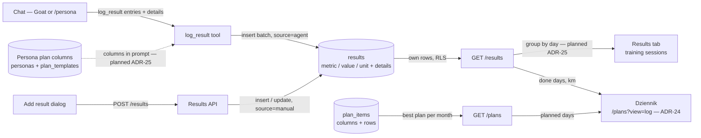

# goat — data flow: workout results and adherence tracking

Interactive, source-linked version (Archify): [`.archify/dataflow-results-adherence-20261011-124302/results-adherence.html`](.archify/dataflow-results-adherence-20261011-124302/results-adherence.html) — editable source: [`candidate.json`](.archify/dataflow-results-adherence-20261011-124302/candidate.json). Regenerate with `node .claude/skills/archify/bin/archify.mjs finalize dataflow <candidate.json> <output.html> --repo-root . --quality showcase`.

- **Implemented (ADR-24):** Dziennik — week rows since the first logged result; each day done / planned / missed / off plan; weekly done/planned column; KPI row; persona filter.
- **Planned (ADR-25):** `results.details` with the persona's plan columns; Results tab shows training sessions per day.
